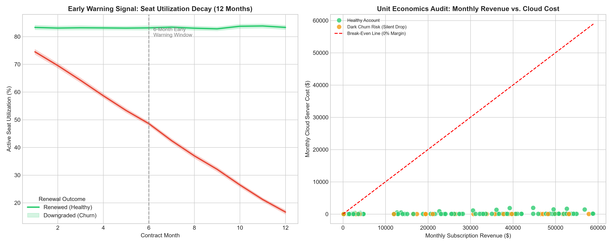
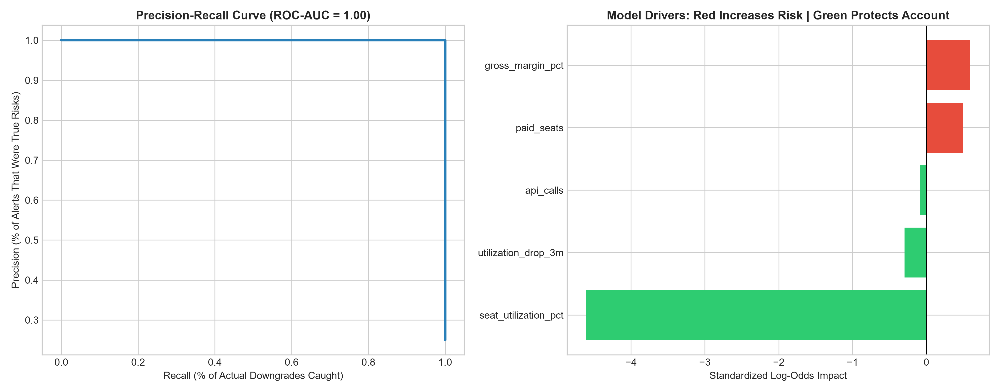

# SaaS "Dark Churn" & Unit Economics Risk Engine

An end-to-end B2B SaaS revenue intelligence and predictive risk pipeline designed to detect **silent contract downgrades ("Dark Churn")** 6 months prior to renewal and isolate **negative-margin accounts ("Toxic Whales")**.

---

## 1. The Business Problem
Standard churn models wait until a customer cancels their subscription—by which point the revenue is already lost. In enterprise B2B SaaS, two hidden issues quietly erode profitability long before renewal:
1. **Silent Contraction (Dark Churn):** Clients maintain active subscriptions while seat utilization steadily decays over 6–9 months, resulting in severe contract downgrades at renewal.
2. **Gross Margin Cannibalization (Toxic Whales):** High-tier clients generate heavy automated API traffic whose underlying cloud infrastructure costs exceed their monthly subscription fees.

---

## 2. End-to-End Pipeline Architecture

    [01_generate_data.py] ──▶ Relational Synthetic Logs (500 Accounts × 12 Months)
              │
              ▼
    [02_unit_economics.py] ──▶ KPI Engineering (Rolling Seat Utilization, Net Profit, Gross Margin)
              │
              ▼
    [03_sql_analytics.py]  ──▶ SQLite Star Schema (dim_accounts & fact_monthly_usage + LAG/RANK Queries)
              │
              ▼
    [04_risk_model.py]     ──▶ Month-6 Logistic Regression Classifier (Leakage-Free Early Warning)
              │
              ▼
    [app.py]               ──▶ Interactive Streamlit Executive Simulator & Portfolio Audit Dashboard

---

## 3. Key Analytical & Modeling Highlights
* **Leakage-Free Early Warning Window:** Trained strictly on **Month 6** behavioral snapshots to predict **Month 12** contract downgrades, giving Customer Success teams a 6-month intervention buffer.
* **Noise-Resistant Telemetry:** Engineered 3-month rolling seat utilization and 90-day velocity drop metrics (`diff(3)`) to distinguish true disengagement from seasonal holiday dips.
* **SQL Star Schema & Window Functions:** Normalized flat logs into `dim_accounts` and `fact_monthly_usage` tables in SQLite, leveraging `LAG() OVER (PARTITION BY ...)` and `RANK()` to prioritize high-MRR intervention lists.
* **Explainable Risk Scoring:** Used L2-regularized Logistic Regression with balanced class weights to extract clear business odds ratios rather than black-box predictions.

---

## 4. Visual Findings

### Unit Economics & Utilization Decay Audit

### Early-Warning Model Validation (Month 6 → Month 12)

---

## 5. How to Run Locally

1. **Clone the repository and install dependencies:**
   `git clone [https://github.com/devbhavsar10/saas-revenue-risk-engine.git](https://github.com/devbhavsar10/saas-revenue-risk-engine.git)`
   `cd saas-revenue-risk-engine`
   `pip install -r requirements.txt`

2. **Execute the data, SQL, and ML pipeline in order:**
   `python 01_generate_data.py`
   `python 02_unit_economics.py`
   `python 03_sql_analytics.py`
   `python 04_risk_model.py`

3. **Launch the interactive Streamlit dashboard:**
   `streamlit run app.py`
